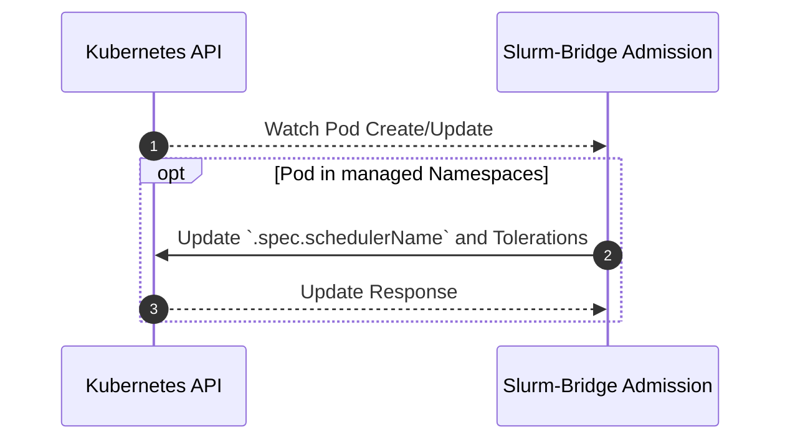

# Admission

## Table of Contents

<!-- mdformat-toc start --slug=github --no-anchors --maxlevel=6 --minlevel=1 -->

- [Admission](#admission)
  - [Table of Contents](#table-of-contents)
  - [Overview](#overview)
  - [Design](#design)
    - [Namespace Selection Contract](#namespace-selection-contract)
    - [Sequence Diagram](#sequence-diagram)

<!-- mdformat-toc end -->

## Overview

[The Kubernetes documentation](https://kubernetes.io/docs/reference/access-authn-authz/admission-controllers/)
defines admission controllers as:

> a piece of code that intercepts requests to the Kubernetes API server prior to
> persistence of the resource, but after the request is authenticated and
> authorized.

It also states that:

> Admission control mechanisms may be validating, mutating, or both. Mutating
> controllers may modify the data for the resource being modified; validating
> controllers may not.

The `slurm-bridge` admission controller is both mutating and validating. It
modifies pods within namespaces specified in `helm/slurm-bridge/values.yaml` to
use the `slurm-bridge` [scheduler] instead of the default Kubernetes scheduler,
and rejects unsupported resource combinations.

## Design

Pods created in selected namespaces with the default Kubernetes scheduler have
their `.spec.schedulerName` changed to the slurm-bridge [scheduler]. An explicit
different, non-default scheduler is not overwritten.

Managed namespaces are defined as a list of namespace as configured in the
admission controller's `values.yaml` for `managedNamespaces[]`. Alternatively, a
`managedNamespaceSelector` can be used to select namespaces based on labels. If
`managedNamespaceSelector` is set, `managedNamespaces` will be ignored.

Managed pods can request either native `cpu` or the CPU DRA extended resource
`deviceclass.resource.kubernetes.io/dra.cpu`, but cannot specify both. CPU DRA
must be requested explicitly; native `cpu` requests are not converted to DRA
requests by the admission controller.

### Namespace Selection Contract

The chart's mutating and validating webhooks both exclude `kube-system` and the
bridge deployment namespace (the release namespace, or `namespaceOverride` when
configured). Kubernetes applies those webhook selectors before calling the
bridge. Neither `admission.managedNamespaces`, namespace labels, nor an explicit
`schedulerName` can override these exclusions. Pods in excluded namespaces
receive no bridge webhook mutation or validation, even if the scheduler itself
can handle a Pod explicitly naming it.

`admission.managedNamespaces` defaults to `[slurm-bridge]`. It is a list of
namespace names, not the namespace where the bridge itself must be installed. A
non-empty `admission.managedNamespaceSelector` takes precedence over the entire
list. The chart default `{}` omits the selector and uses the list. Use
Kubernetes `matchLabels` or `matchExpressions`; do not use an empty selector as
an implicit opt-in to every namespace.

If the bridge is installed in `slurm-bridge`, its default managed namespace is
also excluded: the default list does not enable admission there. Use a separate
application namespace, such as `bridge-acceptance`, for automatically admitted
workloads. This is distinct from the selector-over-list precedence inside the
admission controller.

For a dedicated acceptance environment, install the bridge in its own namespace
and include this fragment in the environment's complete Helm values:

```yaml
admission:
  managedNamespaces:
    - bridge-acceptance
  managedNamespaceSelector: {}
```

Alternatively, select only labeled namespaces:

```yaml
admission:
  managedNamespaceSelector:
    matchLabels:
      bridge-admission: enabled
```

```sh
kubectl create namespace bridge-acceptance
kubectl label namespace bridge-acceptance bridge-admission=enabled
```

The Helm tests cover the non-default namespace and selector-over-list rendering.
The [acceptance runbook](./testing.md#bridge-contract-acceptance) verifies live
webhook behavior. With namespace admission, omit `schedulerName` from the test
Job template and inspect the generated Pod for `slurm-bridge-scheduler`.

In namespaces not excluded by the webhooks, explicitly setting a Pod's
`schedulerName` to the configured bridge scheduler opts it into bridge handling
even outside selected namespaces. It does not prove namespace selection works
and is not a namespace security boundary. Admission validates those explicitly
opted-in Pods too, including protection of bridge-owned job-ID metadata. This
validation does not apply in the excluded namespaces. Selection changes affect
new admission requests; they do not migrate existing workloads to a different
scheduler.

Production admission of `boltz2-dev` or `boltz2` belongs in the infrastructure
repository (`ncats/sci-admin`), not a fork chart default. Namespace selection
does not grant Slurm account/QoS permissions or Kubernetes RBAC permissions.

### Sequence Diagram



<!-- Links -->

[scheduler]: scheduler.md
